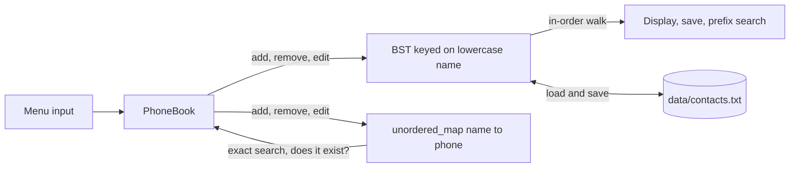

# Phonebook: BST and Hash Map in C++

A menu-driven contact manager that stores every contact in two data structures at once: a
Binary Search Tree for ordering, and a hash map for lookup. Each structure does the job the
other is bad at.

> **Group project**: BEJ32103 Data Structures and Algorithms, Universiti Tun Hussein Onn
> Malaysia, Semester 2 2024/2025.

```text
Enter your choice: 2
Enter name to search (type 'cancel' to return to menu): siti
No exact match. 1 similar contact(s):
  Siti Zubaidah - 012-000 0003

Enter your choice: 5
Contacts (4):
  NAME                        PHONE
  --------------------------------------------
  Ahmad Faizal                012-000 0001
  Nurul Aina                  012-000 0002
  Siti Zubaidah               012-000 0003
  Zamil Hakim                 012-000 0004
```

## The design decision

The obvious implementation is an array or a vector of contacts. That makes display easy, but
every search is a linear scan, and keeping the list alphabetical means re-sorting after each
insert.

This implementation uses two structures instead:

**Binary Search Tree**, keyed on the lowercase name. Contacts land in alphabetical position as
they are inserted, so displaying them in order is an in-order traversal and no sorting
algorithm is ever run. Insert and delete cost O(log N) on average.

**Hash map** (`std::unordered_map<std::string, std::string>`) from lowercase name to phone
number. Search and edit go through this, giving O(1) average lookup instead of the tree's
O(log N).

They are kept in sync on every change. The cost is roughly double the memory; the benefit is
that both common operations are fast, rather than one of them being a compromise.

Names are lowercased into a separate comparison key, so `ahmad` and `Ahmad` resolve to the same
entry rather than creating a duplicate.



### Which structure answers what

| Operation | Goes through | Why |
|---|---|---|
| Search (exact name) | Hash map | O(1) average |
| Edit | Hash map to check, then tree to update | Both copies must change |
| Remove | Hash map to reject unknown names, then tree | Skips a tree walk when the name is not there |
| Display, save | Tree, in-order | Already alphabetical |
| Search (start of name) | Tree, full walk | A hash map cannot answer "starts with" |

### Removing a node with two children

The node's contact is replaced by its in-order successor (the smallest key in the right
subtree), and the successor is then deleted from the right subtree, where it has at most one
child. This keeps the tree in order.

## Complexity

N = number of contacts, L = length of a name.

| Operation | Average | Worst |
|---|---|---|
| `toLower` | O(L) | O(L) |
| `addContact` | O(L log N) | O(N·L) |
| `removeContact` | O(L log N) | O(N·L) |
| `searchContact` | O(L) | O(N·L) |
| `searchByPrefix` | O(N·L) | O(N·L) |
| `displayContacts` | O(N·L) | O(N·L) |
| `saveToFile` | O(N·L) | O(N·L) |
| `loadFromFile` | O(N·L log N) | O(N²·L) |

The worst cases assume a degenerate tree. Inserting contacts in alphabetical order produces
exactly that: the BST collapses into a linked list and every operation becomes linear. A
self-balancing tree (AVL or red-black) would cap this at O(log N).

## Features

- Add, search, edit, remove and display contacts
- Prefix search ("siti" finds "Siti Zubaidah") when the exact name is not found
- Phone number validation: 7 to 15 digits, spaces and dashes allowed, `+` only at the start
- `cancel` at any prompt returns to the menu
- Contacts load from `data/contacts.txt` at startup and are saved on exit
- Malformed lines in the data file are skipped and reported, not crashed on

## Testing

`make test` builds and runs `tests/test_phonebook.cpp`: 38 checks with no test framework, each
printing PASS or FAIL.

| Area | What is checked |
|---|---|
| Phone validation | 7 and 15 digits pass, 6 and 16 fail, letters fail, `+` only allowed first |
| Case and spaces | "ahmad faizal" and "  AHMAD FAIZAL  " find "Ahmad Faizal"; adding it again in another case updates instead of duplicating |
| Order | Contacts inserted out of order display alphabetically |
| Remove | Root with two children, a leaf, a node with one child, and an unknown name; tree and map both updated |
| Edit and prefix search | Edit changes both copies; prefix search is case-insensitive, alphabetical, and does not match the middle of a name |
| Save and load | File is alphabetical; a name with a comma survives a round trip; bad lines are skipped and counted |
| Worst case | 2000 contacts inserted in alphabetical order (a skewed tree), then every other one removed |

All 38 pass with g++ 13.3, and also when built with AddressSanitizer and
UndefinedBehaviorSanitizer (`-fsanitize=address,undefined`), which reports no memory errors or
leaks.

### Fixed after a code review

The same tests were run against the code before these fixes, and 5 of the 38 checks failed.

| Problem | Evidence | Fix |
|---|---|---|
| A name with a comma was corrupted after saving and loading | Adding "Tan, Ali" with 012-000 0009 and restarting gave name "Tan" with phone "Ali,012-000 0009" | Lines are split on the **last** comma, since a phone number can never contain one |
| `+` was accepted anywhere in a number | "12+34-5678" was saved as a valid number | `+` is only allowed as the first character |
| Bad numbers in the data file were loaded | "Bad Number,not a phone" was loaded as a contact | Loaded numbers go through the same validation as typed ones; failures count as malformed lines |
| Skipped lines disappeared without warning | Exit saves the file, so skipped lines were lost silently | A warning now says skipped lines will be removed on the next save |
| Removing a node with two children read a key from a node that was being freed | The successor's own key was passed into the call that deletes it. It worked, but only because the key was not read after the delete | A copy of the key is passed instead |

## Build and run

```bash
make          # build ./phonebook
./phonebook   # run from the repo root so data/contacts.txt is found
make test     # build and run the tests
make clean    # remove build output
```

Requires a C++17 compiler. Tested with g++ 13.3 on Ubuntu 24.04.

## Structure

```
├── src/
│   ├── Contact.h          contact record and BST node
│   ├── PhoneBook.h        class interface with complexity notes
│   ├── PhoneBook.cpp      BST operations, hash map sync, file I/O
│   └── main.cpp           menu loop and input handling
├── tests/
│   └── test_phonebook.cpp 38 unit checks, run with make test
├── data/
│   └── contacts.txt       sample data (name,phone per line)
└── Makefile
```

## Limitations

- **The tree is not balanced.** Alphabetical input turns it into a linked list, and the
  recursive functions then go one call deep per contact, so a very large sorted file could run
  out of stack.
- **Prefix search only matches the start of a name.** "Zubaidah" does not find
  "Siti Zubaidah".
- **One number per contact**, and the name is the unique key, so two people with the same name
  cannot both be stored.
- **Load (menu 7) replaces what is in memory** without asking, so unsaved changes are lost.
- **The data file path is relative**, so the program has to be started from the repo root.

## Possible improvements

- Self-balancing tree (AVL or red-black) so the worst case cannot occur
- A trie for prefix search, replacing the current full tree walk
- Multiple numbers per contact
- Smart pointers instead of raw `new` and `delete`

## License

MIT
